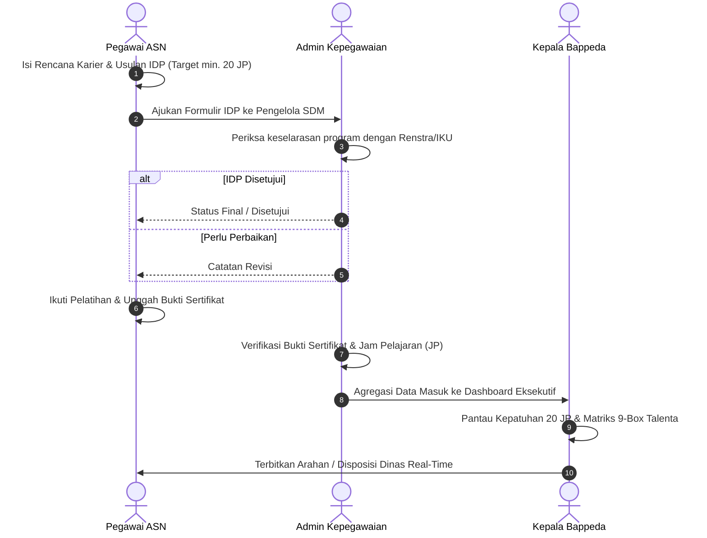

# BUKU PANDUAN PENGGUNA & STANDAR OPERASIONAL PROSEDUR (SOP)
## SISTEM INFORMASI PENGEMBANGAN KOMPETENSI ASN (SIP-KOMPETENSI)
### BADAN PERENCANAAN PEMBANGUNAN DAERAH PROVINSI LAMPUNG

---

| Dokumen | SOP Pengelolaan Individual Development Plan (IDP) ASN |
| :--- | :--- |
| **Nomor SOP** | `000.8.3/SOP-IDP/BAPPEDA/2026` |
| **Tanggal Penetapan** | 02 Januari 2026 |
| **Instansi** | Bappeda Provinsi Lampung |
| **Unit Pengelola** | Subbagian Umum & Kepegawaian (Sekretariat) |
| **Dasar Regulasi** | UU No. 20/2023 Pasal 49, PP No. 17/2020, Perka LAN No. 10/2018 |

---

## 1. DASAR HUKUM & TUJUAN SISTEM

### 1.1 Dasar Regulasi
1. **Undang-Undang Republik Indonesia Nomor 20 Tahun 2023 tentang Aparatur Sipil Negara** (Pasal 49): Mewajibkan setiap ASN melakukan pengembangan kompetensi melalui pembelajaran secara terus-menerus dengan pemenuhan minimal **20 Jam Pelajaran (JP)** per tahun.
2. **Peraturan Pemerintah Nomor 17 Tahun 2020** tentang Perubahan atas PP No. 11 Tahun 2017 tentang Manajemen Pegawai Negeri Sipil.
3. **Peraturan Lembaga Administrasi Negara (LAN) RI Nomor 10 Tahun 2018** tentang Pengembangan Kompetensi Pegawai Negeri Sipil.
4. **Peraturan Menteri PAN-RB Nomor 3 Tahun 2020** tentang Manajemen Talenta ASN.
5. **Peraturan Gubernur Lampung Nomor 54 Tahun 2021** tentang Kedudukan, Susunan Organisasi, Tugas dan Fungsi serta Tata Kerja Bappeda Provinsi Lampung.

### 1.2 Tujuan Penerapan SIP-KOMPETENSI
* Memberikan instrumen digital mandiri bagi seluruh 99 ASN Bappeda Provinsi Lampung dalam merencanakan kebutuhan pengembangan kompetensi (*Individual Development Plan*).
* Menjamin transparansi dan akuntabilitas verifikasi jam pelajaran (JP) dan pengunggahan sertifikat bukti diklat berbasis cloud storage.
* Menyediakan dasbor eksekutif real-time bagi Kepala Bappeda untuk memantau pemenuhan target 20 JP di 7 Unit Kerja serta menyalurkan arahan/disposisi strategis dinas.

---

## 2. STRUKTUR HAK AKSES PERAN (ROLE-BASED ACCESS)

| Peran | Penanggung Jawab Default | Hak Akses Utama |
| :--- | :--- | :--- |
| **Pegawai ASN** | Andi Arafat, S.T., M.E. (Sekretaris) & Seluruh ASN | Profil, Rencana Karier, Matriks Kompetensi, Form Usulan IDP (Min. 20 JP), Unggah Bukti Sertifikat, Cetak IDP Resmi. |
| **Pengelola SDM / Admin** | Cik Marya, S.E., M.M. (Kasubbag Kepegawaian) | Verifikasi Usulan IDP, Verifikasi Berkas Sertifikat Realisasi, Kelola Master Referensi, Ekspor Rekap Excel Dinas, Cadangan Basis Data (*Data Safety*). |
| **Pimpinan / Kepala Badan** | Dr. Anang Risgiyanto, S.K.M., M.Kes. (Kepala Bappeda) | Dashboard Eksekutif Analitik, Matriks 9-Box Talenta ASN, Evaluasi Kepatuhan 7 Bidang, Penerbitan Disposisi Arahan Pimpinan, Cetak Ringkasan Eksekutif. |

---

## 3. PANDUAN PENGGUNA BERDASARKAN PERAN

---

### A. PANDUAN UNTUK PEGAWAI ASN

#### Langkah 1: Masuk ke Portal (Login)
1. Buka laman portal **SIP-KOMPETENSI** di browser PC atau Smartphone.
2. Masukkan **NIP** (18 digit angka) dan **Kata Sandi**.
3. Klik tombol **"Masuk Portal"**.

#### Langkah 2: Lengkapi Rencana Karier & Analisis Kompetensi
1. Buka menu **"Profil Pegawai"** untuk memvalidasi data identitas (Pangkat, Golongan, Jabatan, Unit Kerja).
2. Masuk ke menu **"Rencana Karier"**, tentukan jenjang target promosi/jabatan fungsional yang dituju serta rumpun keahlian utama.
3. Tinjau nilai gap kompetensi manajerial, teknis, dan sosial kultural di menu **"Kompetensi"**.

#### Langkah 3: Pengisian Formulir IDP (Target Minimal 20 JP)
1. Buka menu **"IDP Saya"**.
2. Klik tombol **"+ Tambah Program Pengembangan"**.
3. Pilih metode pengembangan (Klasikal: Diklat Teknis/Workshop, Non-Klasikal: Coaching, Mentoring, E-Learning).
4. Masukkan topik diklat, lembaga penyelenggara, estimasi waktu, dan jumlah jam pelajaran (JP).
5. Pastikan total rencana program mencapai **minimal 20 JP** sesuai amanat UU No. 20/2023.
6. Klik tombol **"Ajukan Formulir ke Atasan/Admin"**.

#### Langkah 4: Pelaksanaan & Pengunggahan Bukti Sertifikat
1. Setelah mengikuti kegiatan pengembangan, buka menu **"Pelaksanaan SDM"**.
2. Klik tombol **"Tambah Bukti Pelaksanaan"**.
3. Masukkan nama diklat, tanggal selesai, dan jumlah JP riil.
4. Unggah berkas dokumen sertifikat/surat tugas format PDF/JPG/PNG.
5. Pantau status verifikasi sertifikat oleh Subbagian Umum & Kepegawaian.

#### Langkah 5: Cetak Formulir IDP Resmi
1. Di halaman **"IDP Saya"**, klik tombol **"🖨️ Cetak / Unduh Dokumen IDP (.PDF)"**.
2. Pilih format orientasi halaman (**Potret / Lanskap**).
3. Pada dialog cetak browser, pilih *"Simpan sebagai PDF"* untuk mengunduh berkas bertanda tangan resmi.

---

### B. PANDUAN UNTUK ADMIN KEPEGAWAIAN (PENGELOLA SDM)

#### Langkah 1: Verifikasi Usulan Formulir IDP
1. Masuk menggunakan akun Pengelola SDM (NIP Kasubbag Kepegawaian).
2. Buka menu **"Verifikasi IDP"** (`averif`).
3. Klik salah satu pengajuan pegawai berstatus *"Diajukan ke Atasan"*.
4. Periksa relevansi topik pelatihan dengan sasaran kinerja pegawai.
5. Pilih aksi:
   * **Setujui Formulir**: Status berubah menjadi *Final*, data tercatat resmi.
   * **Minta Revisi**: Masukkan catatan perbaikan (misal: "Tambahkan program fungsional perencanaan agar genap 20 JP").

#### Langkah 2: Verifikasi Bukti Sertifikat Pelatihan
1. Buka menu **"Pelaksanaan SDM"** (`apelaksanaan`).
2. Periksa berkas bukti sertifikat yang diunggah pegawai.
3. Klik tombol *"Validasi Sertifikat"* untuk mengonfirmasi perolehan Jam Pelajaran (JP). Jam pelajaran yang disetujui akan langsung menambah capaian persentase 20 JP pegawai secara live.

#### Langkah 3: Ekspor Rekapitulasi Laporan Dinas
1. Pada menu **"Data Pegawai"** atau **"Verifikasi"**, klik tombol **"Ekspor Laporan (.XLSX)"**.
2. Berkas Excel berisi rekapitulasi capaian 99 ASN, jam pelajaran, dan status kepatuhan otomatis diunduh untuk bahan evaluasi BKD Provinsi Lampung.

#### Langkah 4: Pencadangan & Pemulihan Basis Data (Data Safety)
1. Buka menu **"Master Data"** &rarr; tab **"Cadangan & Keamanan Data"**.
2. Klik tombol **"Unduh Cadangan (.JSON)"** untuk mengamankan seluruh basis data sistem.
3. Simpan berkas cadangan secara berkala setiap akhir bulan.
4. Apabila terjadi kendala sistem, gunakan panel *"Pemulihan Basis Data"* untuk memulihkan data dari berkas cadangan resmi.

---

### C. PANDUAN UNTUK KEPALA BAPPEDA (PIMPINAN)

#### Langkah 1: Monitoring Dashboard Eksekutif
1. Masuk dengan akun Pimpinan Badan.
2. Dashboard Eksekutif (`pdash`) menampilkan:
   * **KPI Kepatuhan 20 JP**: Persentase pegawai yang telah memenuhi syarat 20 JP.
   * **Rata-rata JP Pegawai Bappeda**: Akumulasi capaian per ASN.
   * **Sebaran Kepatuhan 7 Bidang**: Grafik perbandingan kepatuhan unit kerja.
   * **Matriks 9-Box Grid**: Pemetaan talenta berdasarkan potensi dan kinerja ASN.

#### Langkah 2: Evaluasi Unit Kerja di Menu Monitoring
1. Buka menu **"Monitoring"** (`pmonitoring`).
2. Amati peringkat kepatuhan per bidang (Sekretariat, PMPE, Perekonomian, Infrastruktur & Kewilayahan, Pemerintahan & PM, Pusdatin, UPTD).
3. Identifikasi unit yang berstatus *"Perlu Pembinaan"* atau memiliki tingkat partisipasi rendah.

#### Langkah 3: Penerbitan Instruksi / Disposisi Arahan Dinas
1. Pada Dashboard Pimpinan, temukan panel **"Instruksi & Arahan Strategis Kepala Badan"**.
2. Masukkan instruksi kedinasan pada kolom yang tersedia (misal: *"Percepat pelatihan fungsional perencana sebelum Triwulan II"*).
3. Tentukan target penerima: *Semua Bidang (99 ASN)* atau pilih unit bidang spesifik.
4. Klik tombol **"Terbitkan"**.
5. Arahan otomatis tersiar secara *real-time* ke dashboard pegawai dan admin, disertai notifikasi lonceng dinas.

#### Langkah 4: Cetak Laporan Eksekutif Resmi
1. Buka menu **"Laporan"** (`plaporan`).
2. Klik tombol **"Cetak Rekapitulasi Eksekutif (.PDF)"**.
3. Dokumen resmi ber-kop Pemerintah Provinsi Lampung siap dicetak sebagai bahan rapat pimpinan bersama Gubernur atau BKD.

---

## 4. STANDAR PELAYANAN OPERASIONAL (SLA)

| No | Tahapan Pelayanan | Pelaksana | Batas Waktu Maksimal (SLA) | Output |
| :---: | :--- | :--- | :---: | :--- |
| 1 | Pengisian IDP Awal Tahun | Pegawai ASN | Akhir Triwulan I (31 Maret) | Draf Usulan IDP Minimal 20 JP |
| 2 | Verifikasi & Persetujuan IDP | Kasubbag Kepegawaian | Maks. 3 (tiga) Hari Kerja | IDP Status Final / Disetujui |
| 3 | Unggah Bukti Sertifikat Diklat | Pegawai ASN | Maks. 7 hari pasca-kegiatan | Berkas Sertifikat Digital Cloud |
| 4 | Validasi JP Pelatihan | Pengelola SDM | Maks. 2 (dua) Hari Kerja | JP Terverifikasi & Akumulasi Live |
| 5 | Evaluasi Kepatuhan & Arahan | Kepala Bappeda | Setiap Akhir Triwulan & Semester | Disposisi Arahan & Laporan Eksekutif |
| 6 | Pencadangan Basis Data | Pengelola SDM | Tanggal terakhir setiap bulan | Berkas Arsip `.json` Terenkripsi |

---

## 5. PANDUAN PENGGUNAAN APLIKASI DI SMARTPHONE (PWA)

Aplikasi **SIP-KOMPETENSI** telah mendukung teknologi **Progressive Web App (PWA)** sehingga dapat dipasang layaknya aplikasi native tanpa Play Store / App Store:

1. **Untuk Android (Google Chrome / Edge)**:
   * Buka tautan website &rarr; ketuk tombol biru **"Pasang di HP"** di bagian atas layar atau buka menu browser (titik tiga ⋮) &rarr; pilih **"Instal Aplikasi"**.
2. **Untuk iPhone / iPad (Safari)**:
   * Buka tautan website &rarr; ketuk ikon **Bagikan (Share ⎋)** di bagian bawah layar &rarr; pilih **"Tambah ke Layar Utama" (+)** &rarr; ketuk **Tambah**.
3. **Pintasan Cepat (App Shortcut)**:
   * Tekan dan tahan ikon aplikasi di beranda smartphone untuk langsung membuka menu **"IDP Saya"** atau **"Pelaksanaan SDM"**.

---

*Ditetapkan di Bandar Lampung pada tanggal 02 Januari 2026*  
**BADAN PERENCANAAN PEMBANGUNAN DAERAH PROVINSI LAMPUNG**
